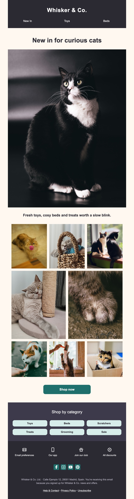
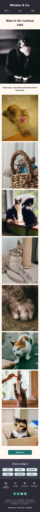

# Whisker & Co. — Email promocional responsive con MJML

Email promocional para **Whisker & Co.**, una tienda ficticia de accesorios para gatos. El objetivo del proyecto es mostrar cómo construyo un email HTML responsive con **MJML**: desde la maquetación hasta la compilación, la optimización y las pruebas en clientes de correo reales.

La estructura está inspirada en un email promocional de comercio electrónico (cabecera, imagen principal, rejilla de productos, llamada a la acción, categorías y pie). La marca, los textos, la paleta de colores y las imágenes son propios del proyecto.

## Vista previa

| Escritorio | Móvil |
|---|---|
|  |  |

## Tecnologías

- **MJML 5.4.1** — framework de maquetación que compila a HTML compatible con clientes de correo (tablas, estilos inline y condicionales para Outlook).
- **HTML para email** — ancho estándar de 600 px y tipografía con fuentes seguras (Arial, Helvetica).
- **Mailtrap (Email API)** — envío de pruebas a bandejas de entrada reales.

## Estructura del proyecto

```
email/
├── src/index.mjml      # Código fuente MJML
├── dist/index.html     # HTML compilado, listo para enviar
└── images/
    ├── photos/         # Fotografías (JPG a 2×)
    └── icons/          # Iconos del pie (PNG)
screenshots/            # Capturas de escritorio y móvil
```

El HTML compilado se incluye en el repositorio a propósito: es el archivo que se envía y permite revisar el resultado sin instalar MJML.

## Cómo compilar

Requisitos: Node.js y MJML instalado globalmente (`npm install -g mjml`).

```bash
mjml email/src/index.mjml -o email/dist/index.html
```

Durante el desarrollo, el modo *watch* recompila en cada guardado:

```bash
mjml -w email/src/index.mjml -o email/dist/index.html
```

## Técnicas de MJML utilizadas

- **`mj-attributes`, `mj-all` y `mj-class`** — valores por defecto globales y clases reutilizables, de modo que el `mj-body` contiene solo estructura y contenido. Un cambio de color o de espaciado se hace en una sola línea.
- **`mj-section` / `mj-column`** — rejilla de productos 3-2-3. Las columnas se apilan en móvil sin escribir media queries a mano.
- **`fluid-on-mobile`** — las fotos de la rejilla ocupan todo el ancho al apilarse, en lugar de mantener su tamaño de escritorio.
- **`mj-group`** — mantiene en una sola fila, también en móvil, la navegación, los botones de categoría y los iconos del pie.
- **`mj-wrapper`** — agrupa varias secciones con un fondo común (bloque de categorías y pie).
- **`mj-button`** — botones *bulletproof*: HTML en lugar de imágenes, con relleno alternativo para Outlook (`mso-padding-alt`).
- **`mj-social`** — iconos de redes sociales sin archivos propios. Uso de las variantes `-noshare` para enlazar al perfil de la marca en lugar de abrir un diálogo de compartir.
- **`mj-style`** — estilos `inline="inline"` para los enlaces (clientes que eliminan el `<style>` del `<head>`) y una regla separada en el `<head>` para lo que no puede incluirse inline.
- **`mj-preview`** — texto de previsualización que aparece junto al asunto en la bandeja de entrada.

## Decisiones específicas de email

- **Imágenes con URLs públicas.** Los clientes de correo no pueden cargar rutas locales; las imágenes se sirven desde `raw.githubusercontent.com`. Las rutas comparten un prefijo común, así que el cambio de entorno se hace con un único buscar y reemplazar.
- **Imágenes a 2× y optimizadas.** Cada foto se exporta al doble de su tamaño de visualización para pantallas retina y pesa menos de 200 KB (1,4 MB en total).
- **HTML de 69 KB.** Por debajo del límite de ~102 KB a partir del cual Gmail recorta el mensaje y oculta el pie, incluido el enlace de baja.
- **Área clicable de los botones de categoría.** Con un ancho en porcentaje, MJML aplica el ancho a la celda pero no al enlace, y solo el texto era clicable. Una regla `display: block !important` en el `<head>` amplía el enlace a todo el botón; los clientes que ignoran el `<head>` mantienen un comportamiento aceptable.
- **Accesibilidad.**
  - Textos `alt` descriptivos en todas las fotos y `alt=""` en los iconos decorativos, que ya tienen una etiqueta de texto.
  - `lang="en"` en el documento para los lectores de pantalla.
  - Contraste comprobado según WCAG: botón principal 5,9:1, botones de categoría 11,6:1, texto legal 7,1:1.
  - Los enlaces legales van subrayados para no depender solo del color.
- **Unidades de `line-height`.** MJML solo acepta `px` o `%` en `mj-text`; se usan valores en píxeles y un `line-height` propio en los textos grandes para evitar líneas superpuestas.

## Pruebas

El HTML compilado se envió a través de la API de Mailtrap y se revisó en:

- Gmail web (Safari, macOS)
- Apple Mail (macOS)
- Apple Mail (iOS)

En los tres clientes se comprobó la carga de imágenes, el apilado de la rejilla en móvil, los botones, el pie y el texto de previsualización.

## Qué aprendí

- Por qué el HTML para email sigue basándose en tablas y estilos inline, y cómo MJML genera ese código a partir de una sintaxis basada en componentes.
- Que cada `mj-section` sin `padding` explícito recibe 20 px arriba y abajo, y que el espaciado de una rejilla se construye con el padding de las secciones y de las imágenes, no con `gap`.
- La diferencia entre `mj-class` (atributos de MJML) y `css-class` (clases CSS en el HTML resultante), y que las clases se combinan en la etiqueta, no dentro de otra clase.
- Que los validadores comprueban el formato y no el sentido: `line-height="1.5px"` es válido, pero rompe el texto en varias líneas.
- Que cada cliente de correo trata el HTML a su manera, por lo que las pruebas en clientes reales son imprescindibles.

## Créditos

- Fotografías: [Pexels](https://www.pexels.com), bajo la licencia de Pexels.
- Iconos del pie: [SVG Repo](https://www.svgrepo.com), convertidos a PNG.
- Iconos de redes sociales: incluidos en MJML.
- Marca, textos y dirección ficticios, creados para este proyecto.

## Autor

**Aleksei Smirnov** — [GitHub](https://github.com/AxelVonReems)
